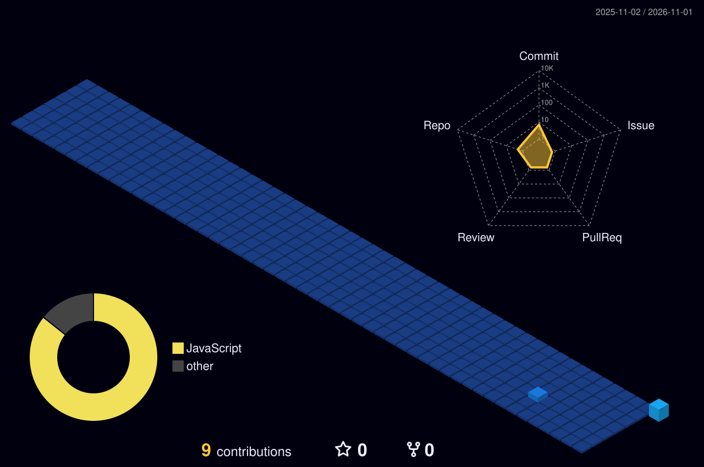

  

 

  

  

  

## Trabalhos

<table>
<tr><th>Site</th><th>O que é</th><th>Tipo</th></tr>
<tr><td><a href="https://alavo.com.br"><b>Alavo</b></a></td><td>Site da Alavo, a empresa de tecnologia e IA que estou abrindo com o meu sócio.</td><td><code>Site de empresa</code></td></tr>
<tr><td><a href="https://solaro-joias.netlify.app"><b>Solaro</b></a></td><td>Site novo da @solaro_co, joias em prata com estética medieval e gótica, com pedido pelo WhatsApp.</td><td><code>Loja virtual</code></td></tr>
<tr><td><a href="https://eto-gallery.netlify.app"><b>Êto Gallery</b></a></td><td>Site próprio da @etogallery, streetwear do Capão Redondo, com o comprar caindo no carrinho deles.</td><td><code>Loja virtual</code></td></tr>
<tr><td><a href="https://joaobasso.online"><b>davizão</b></a></td><td>Mídia kit costuma ser um PDF. O do @ddavzao eu fiz em site.</td><td><code>Mídia kit em site</code></td></tr>
<tr><td><a href="https://joaobasso.online"><b>Connquer</b></a></td><td>O drop novo da @connquer.co tem filme, ensaio e até jogo. Faltava o site do drop.</td><td><code>Site do drop</code></td></tr>
<tr><td><a href="https://www.instagram.com/p/Defg7eSlPci/"><b>AEVUS+</b></a></td><td>Como seria a loja da @atelieraevus se ela saísse da minha cabeça.</td><td><code>Loja · projeto pessoal</code></td></tr>
<tr><td><a href="https://www.instagram.com/p/DeUJV0NFf6L/"><b>BLIME</b></a></td><td>Uma ideia de madrugada olhando o Instagram da BLIME.</td><td><code>Loja · projeto pessoal</code></td></tr>
</table>

<a href="https://joaobasso.online"><b>→ Ver mais no joaobasso.online</b></a>

## Aplicativos

<table>
<tr><th>Aplicativo</th><th>O que faz</th><th>Para quem</th></tr>
<tr><td><a href="https://tabela-vendas-3d.netlify.app"><b>Tabela de vendas 3D</b></a></td><td>Espelho de vendas do prédio em 3D: o corretor clica no apartamento e vê situação, planta, valor e simulação de pagamento.</td><td><code>Incorporadora</code></td></tr>
<tr><td><a href="https://fazendatestee.netlify.app"><b>Fazenda 3D</b></a></td><td>Maquete 3D da fazenda com os talhões por cultura, o calendário da safra, os silos e as anotações do estoque.</td><td><code>Agro</code></td></tr>
<tr><td><a href="https://marcenaria-3d.netlify.app"><b>Marcenaria 3D</b></a></td><td>O marceneiro monta o móvel em 3D e sai com a lista de corte, o plano das chapas, as ferragens e a planilha do Excel.</td><td><code>Marcenaria</code></td></tr>
<tr><td><a href="https://monte-sua-casa.netlify.app"><b>Monte Sua Casa</b></a></td><td>A pessoa desenha a planta, põe os móveis e vê a casa em 3D.</td><td><code>Qualquer pessoa</code></td></tr>
<tr><td><b>Radar de Clientes</b></td><td>Acha no Google Maps os negócios sem site, monta uma prévia do site e abre o WhatsApp com a mensagem pronta.</td><td><code>Programa no PC</code></td></tr>
<tr><td><b>Jogos da Live</b></td><td>Jogos na tela da live do TikTok: comentário, curtida e presente viram ação no jogo.</td><td><code>Programa no PC</code></td></tr>
</table>

 

### Minha cidade de contribuições

*Cada contribuição levanta mais um prédio. O GitHub refaz a cidade sozinho, todo dia.*

  

  

 

**Mande SITE no direct do @joaobass0.**

